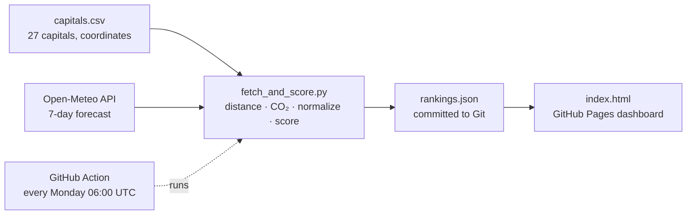

# EU capitals — sustainable vacation dashboard

**TD1 · Business Intelligence** — an automated BI pipeline, from a live weather API to
a public decision dashboard.

**Live dashboard:** https://adam-hassen-bi.github.io/eu-capitals-dashboard-Td1/

> **The decision it supports:** which EU capital offers the best vacation conditions
> next week, while minimizing the CO₂ emissions of getting there from Le Mans?

A dashboard is only worth building if it answers a real question for a real person at
the moment they need it. This one answers *"where should I go next week?"* by
weighing two things that pull in opposite directions: good weather is mostly far
south, low CO₂ is mostly close by.

---

## How it works



| BI stage | What happens | Where |
|---|---|---|
| **Acquisition** | Static reference table (coordinates never change) + live weather API called on every run (one batched request for all capitals, no API key) | `data/capitals.csv`, `scripts/fetch_and_score.py` |
| **Transformation** | Great-circle distance (haversine), round-trip CO₂, min–max normalization of every measure to 0–1 | `scripts/fetch_and_score.py` |
| **KPI** | Weather score + CO₂ score combined into one final score | `scripts/fetch_and_score.py` |
| **Storage** | Result written to JSON and **committed** — every past ranking is kept in Git history | `docs/data/rankings.json` |
| **Visualization** | Interactive decision dashboard | `docs/index.html` |
| **Automation** | Scheduled GitHub Action re-runs the whole pipeline and commits the result | `.github/workflows/update-data.yml` |

## The score

All measures are computed over the next 7 days, then **normalized across the 27
capitals** (best = 1, worst = 0):

| Measure | Source | Better when |
|---|---|---|
| Average max temperature | Open-Meteo `temperature_2m_max` | higher |
| Average sunshine | Open-Meteo `sunshine_duration` | higher |
| Total rain | Open-Meteo `precipitation_sum` | lower |
| CO₂ round trip | distance × 2 × 0.15 kg CO₂e / passenger-km | lower |

```
weather_score = (temp_score + sun_score + rain_score) / 3
final_score   = 0.5 × weather_score + 0.5 × co2_score
```

The 50 / 50 weighting is a **choice, not a fact** — the dashboard's slider lets anyone
test their own trade-off. Because of normalization, scores are relative: a city's
score can change when another city is added, even if its own weather does not.

## The dashboard

- **Freshness badge** — turns orange if the data is more than 8 days old, so a
  visitor can see when the pipeline has stopped without opening the Actions tab.
- **Weight slider** (with *Planet first / Balanced / Sun first* presets) — re-ranks
  every chart live. At 50 / 50 the winner is a sunny mid-distance capital; at 20 / 80
  it becomes the closest one.
- **Recommendation card** — the #1 capital, its real forecast values, and its four
  sub-scores showing *why* it wins.
- **Map** — every capital sized and shaded by score, with the trip to the
  recommended one.
- **Ranking — and why** — each bar split into what weather and CO₂ contribute.
- **Trade-off chart** — weather against CO₂. The blue line joins every point with
  the same score as the #1 (nothing sits above it); the dashed line is the
  *no-regret frontier*, the capitals that no other city beats on both criteria.
- **Data table** — all raw values, sortable.

Works on mobile and follows the system light / dark mode.

## Run it locally

```bash
git clone https://github.com/adam-hassen/eu-capitals-dashboard.git
cd eu-capitals-dashboard
python3 serve.py             # opens the dashboard on http://localhost:8000
```

To recompute the ranking with today's forecast before opening it:

```bash
pip3 install requests
python3 serve.py --refresh
```

> Opening `docs/index.html` by double-click does not work: the page loads its data
> with `fetch()`, which browsers block on `file://`. `serve.py` serves it over HTTP.

## Change the departure city

The origin is defined in one place, at the top of `scripts/fetch_and_score.py`:

```python
ORIGIN_NAME = "Le Mans"
ORIGIN_LAT, ORIGIN_LON = 48.0061, 0.1996
```

The script writes the origin into `rankings.json`, and the page reads it from there —
no city name is hardcoded in the HTML. If the origin is one of the 27 capitals, it is
automatically excluded from its own ranking.

## Automation

The workflow runs **every Monday at 06:00 UTC** and can be started manually from the
**Actions** tab (*Update capitals ranking → Run workflow*). It needs
*Settings → Actions → General → Workflow permissions → Read and write* to commit its
result.

GitHub disables scheduled workflows after 60 days without repository activity — the
freshness badge on the page is what makes that visible.

## Repository layout

```
.github/workflows/update-data.yml   scheduled pipeline
data/capitals.csv                   static reference table
scripts/fetch_and_score.py          acquisition, transformation, scoring
docs/index.html                     dashboard (GitHub Pages source)
docs/data/rankings.json             generated by the Action
serve.py                            local preview
REFLECTIONS.md                      answers to the TD questions
```

## Limits

- CO₂ uses a single average short-haul factor (0.15 kg CO₂e / passenger-km) and
  great-circle distance; it ignores real routes, aircraft type and non-CO₂ effects.
- Capital coordinates are city-centre approximations.
- A 7-day forecast becomes less reliable towards the end of the week.

## Credits

Weather data: [Open-Meteo](https://open-meteo.com) (CC BY 4.0) · Map tiles:
© OpenStreetMap contributors © CARTO · Map library: Leaflet.
